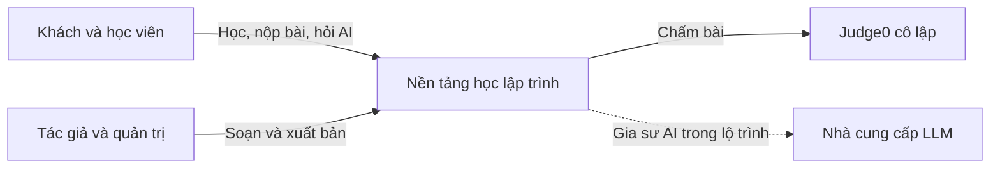
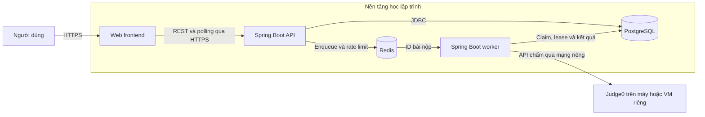

- **Mục đích** Chốt ranh giới nghiệp vụ và đường đi của dữ liệu.
- **Đối tượng đọc** Dev, reviewer và vận hành.
- **Cập nhật lần cuối** 2026-11-25
- **Owner** Backend

# Kiến trúc backend

Backend dùng Modular Monolith với một Maven build và một PostgreSQL. Cùng artifact Spring Boot chạy hai tiến trình, API và worker chấm bài. API truy cập PostgreSQL và Redis. Worker nhận việc qua Redis, chốt trạng thái vào PostgreSQL và gọi Judge0 qua adapter. [ADR 0001](adr/0001-modular-monolith.md) · [ADR 0002](adr/0002-sandbox-worker-and-queue.md) · [Hiện trạng](PROJECT_STATUS.md)

## C4 Context và Container





## Ranh giới

| Module | Kiến trúc nội bộ | Trạng thái |
| --- | --- | --- |
| `content` | `CatalogController → CatalogService → CatalogRepository`, DTO catalog và bảng `course`, `lesson`. | API đọc đã xuất bản. Admin và xuất bản theo [kế hoạch Khóa học](COURSE_MODULE_PLAN.md). |
| `identity` | `AuthController → AuthService → AccountRepository`. Spring Security cấp quyền, Spring Session JDBC lưu phiên. `CurrentUser` cung cấp ID cho module khác. | Email, hồ sơ, đổi và thu hồi phiên hoạt động. |
| `sandbox` | `ExerciseController → ExerciseService → ExerciseRepository` đọc bài tập và view test công khai. `SandboxClient` là port, `Judge0Client` là adapter của worker. | API bài tập, cấu hình giới hạn và adapter có test với stub. |
| `submission` | `SubmissionController → SubmissionService → SubmissionRepository`. Worker dùng `GradingService` và `GradingRepository`, nối Redis qua `SubmissionQueue`. | Nộp bài, polling, lịch sử và verdict Python có kiểm thử. |
| `common` | Security filter, health, request ID và Problem Detail. | Dùng chung cho các API. |
| `learning` | Roadmap và tiến độ theo người học, theo thiết kế. | Backlog. |
| `tutor` | Bậc gợi ý và adapter LLM, theo thiết kế. | Backlog. |

- Mỗi module ghi bảng của mình qua repository nội bộ. Module gọi nhau qua API Java công khai và model biên. Một PR thêm dependency phải kiểm tra hướng phụ thuộc và tránh chu trình để giữ khả năng tách module.
- PostgreSQL là nguồn dữ liệu chuẩn cho bài nộp. Sau commit, API enqueue ID qua Redis. Worker có thể lấy bài chờ từ PostgreSQL, cập nhật lease trước từng test case và chỉ ghi kết quả nếu còn giữ đúng attempt. Rollout runner thực cần môi trường cô lập và nghiệm thu riêng. [Thiết kế Sandbox](sandbox/ARCHITECTURE.md)
- Phần giao với Khóa học dùng `exercise.lesson_id`. Truy vấn bài tập hiện join để lọc trạng thái xuất bản của khóa và bài. Hợp đồng khám phá bài tập theo bài học cần nằm trong OpenAPI khi tích hợp frontend.

Ví dụ ranh giới Java cho module tương lai.

```java
// ✅ Tutor đọc ngữ cảnh công khai qua hợp đồng của Content.
var context = lessonContextReader.getPublishedLesson(courseSlug, lessonSlug);
// ❌ Tutor truy cập trực tiếp repository nội bộ của Content.
// var context = catalogRepository.findPublishedLesson(courseSlug, lessonSlug);
```

[Cấu trúc thư mục](FOLDER_STRUCTURE.md) · [Dữ liệu](DATABASE.md) · [Bảo mật](AUTH_SECURITY.md) · [Deploy](DEPLOYMENT.md)

## Checklist

- [ ] Mỗi thay đổi có một module sở hữu dữ liệu hoặc hành vi.
- [ ] Dependency mới đi qua hợp đồng công khai và không tạo chu trình.
- [ ] Tích hợp gửi dữ liệu ra ngoài đã đối chiếu quy tắc bảo mật.
