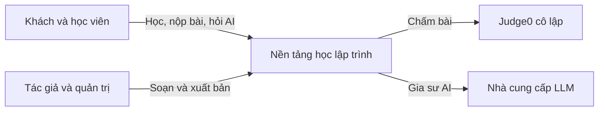
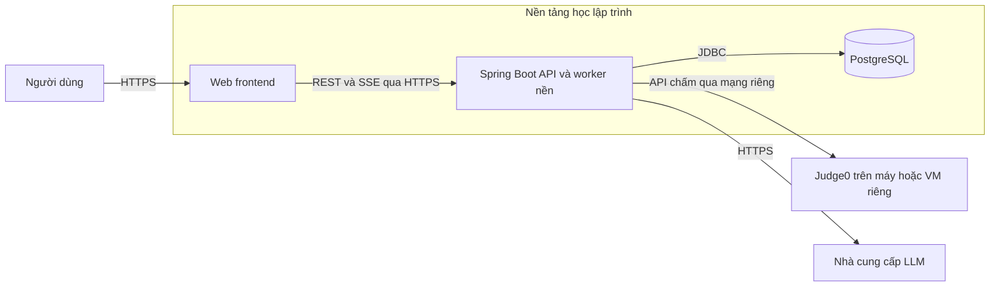

- **Mục đích** Chốt ranh giới nghiệp vụ và đường đi của dữ liệu.
- **Đối tượng đọc** Dev, reviewer và vận hành.
- **Cập nhật lần cuối** 2026-11-25
- **Owner** Backend

# Kiến trúc backend

Hiện có `content` đọc danh mục, `identity` quản lý tài khoản và phiên, và `common` xử lý hạ tầng HTTP. Kiến trúc MVP đã duyệt gồm một ứng dụng Spring Boot, một Maven build và một PostgreSQL. `learning`, `submission` và `tutor` thuộc các mốc tiếp theo. [ADR 0001](adr/0001-modular-monolith.md) · [Roadmap](ROADMAP.md)

## C4 Context và Container





## Ranh giới

| Module | Sở hữu |
| --- | --- |
| `content` | Khóa, bài học, nội dung bài tập và CMS |
| `identity` | Tài khoản, vai trò và chính sách phiên |
| `learning` | Roadmap và tiến độ |
| `submission` | Bài nộp, chấm điểm, verdict và worker |
| `tutor` | Bậc gợi ý, hạn mức và giao tiếp LLM |
| `common` | Hạ tầng HTTP dùng chung, như health và xử lý lỗi |

- Mỗi module ghi bảng của mình qua repository nội bộ. Module gọi nhau qua API Java công khai và model biên. Một PR thêm dependency phải kiểm tra hướng phụ thuộc và tránh chu trình để giữ khả năng tách module.
- PostgreSQL giữ cả bài nộp và trạng thái hàng đợi để tránh ghi riêng hai hệ thống. API chỉ trả `202` sau khi commit. Worker cùng tiến trình nhận việc bằng lease, gọi Judge0 ngoài transaction, đặt giới hạn retry cho lỗi hạ tầng và ghi kết quả theo ID bài nộp để xử lý lại an toàn. Đánh giá tách worker khi tải chấm ảnh hưởng API hoặc có nhu cầu scale riêng. Judge0 nằm ở ranh giới thực thi riêng ngay khi bật mã thật.
- ADR kế tiếp ghi quyết định về dữ liệu, phiên và phân quyền, hàng đợi chấm, REST/SSE, và quyền riêng tư AI khi các thiết kế chi tiết được chốt.

Ví dụ ranh giới Java cho module tương lai.

```java
// ✅ Tutor đọc ngữ cảnh công khai qua hợp đồng của Content.
var context = lessonContextReader.getPublishedLesson(courseSlug, lessonSlug);
// ❌ Tutor truy cập trực tiếp repository nội bộ của Content.
// var context = catalogRepository.findPublishedLesson(courseSlug, lessonSlug);
```

[Cấu trúc thư mục](FOLDER_STRUCTURE.md) · [Dữ liệu](DATABASE.md) · [Bảo mật](AUTH_SECURITY.md) · [Deploy](DEPLOYMENT.md)

## Checklist

- [ ] Mỗi thay đổi có một module sở hữu dữ liệu hoặc hành vi.
- [ ] Dependency mới đi qua hợp đồng công khai và không tạo chu trình.
- [ ] Tích hợp gửi dữ liệu ra ngoài đã đối chiếu quy tắc bảo mật.
