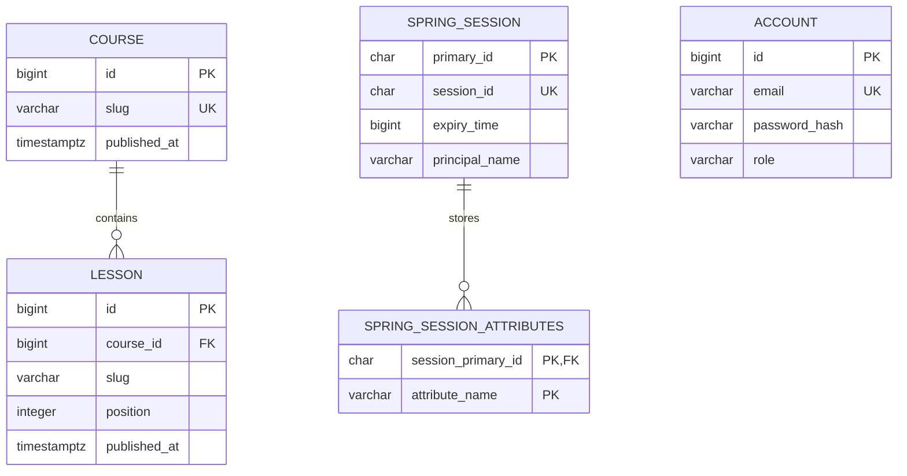

- **Mục đích** Quản lý schema PostgreSQL và truy vấn theo module.
- **Đối tượng đọc** Dev backend và reviewer.
- **Cập nhật lần cuối** 2026-11-25
- **Owner** Backend

# Dữ liệu và migration

## ERD hiện tại



`lesson` có hai unique constraint ghép là `(course_id, slug)` và `(course_id, position)`. Xem SQL cho đầy đủ cột và constraint. [Migration V1](../backend/src/main/resources/db/migration/V1__create_catalog.sql)

`account.email` được chuẩn hóa về chữ thường trước khi ghi. Spring Session dùng `principal_name` để tra phiên của tài khoản, và trường này để trống với phiên ẩn danh. Flyway quản lý cả bảng phiên và bảng tài khoản. [Migration V2](../backend/src/main/resources/db/migration/V2__create_identity.sql)

Sandbox nối `exercise.lesson_id` với `lesson`. PostgreSQL giữ bài nộp và verdict. Worker dùng `attempt_count` và `lease_expires_at` để kiểm soát recovery. V7 cấp mặc định mà giữ các giá trị đã cấu hình, V8 bổ sung lease. [Mô hình dữ liệu Sandbox](sandbox/DATA-MODEL.md) · [ADR worker](adr/0002-sandbox-worker-and-queue.md)

- Tên bảng/cột dùng `snake_case`. Đặt khóa chính `id`, khóa ngoại `<table>_id` và cột thời điểm `timestamptz` để việc join và xử lý timezone nhất quán.
- Tạo migration `V<n>__<verb>_<noun>.sql` theo version kế tiếp. Giữ checksum của migration đã áp dụng. Chạy Flyway trên DB trống và DB ở version trước để kiểm tra cài mới lẫn nâng cấp.
- Repository bind tất cả giá trị, chọn cột cần đọc, có `ORDER BY` ổn định khi phân trang. Với index mới, ghi truy vấn đích và kiểm tra kế hoạch bằng `EXPLAIN` trên dữ liệu đại diện.
- Mỗi module ghi bảng của mình. Dùng transaction service cho thao tác nguyên tử, kết thúc transaction trước khi gọi Judge0 hoặc LLM. Seed demo chỉ nạp qua cấu hình local hoặc test đã chỉ định.

```java
// ✅ Giá trị URL được bind qua JdbcClient.
var rows = jdbc.sql("SELECT id FROM course WHERE slug = :slug")
        .param("slug", slug).query(Long.class).list();
// ❌ jdbc.sql("SELECT id FROM course WHERE slug = '" + slug + "'");
```

[Kiến trúc](ARCHITECTURE.md) · [Cài đặt local](ENVIRONMENT_SETUP.md) · [Deploy](DEPLOYMENT.md)

## Checklist

- [ ] Migration mới áp dụng được từ schema trống và version liền trước.
- [ ] Constraint giữ đúng bất biến và truy vấn dùng bind parameter.
