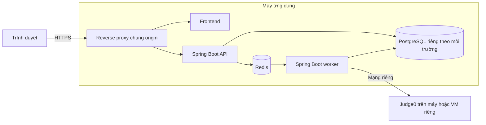

- **Mục đích** Đưa backend lên môi trường dùng chung và kiểm tra khả năng phục hồi.
- **Đối tượng đọc** Vận hành, dev và reviewer.
- **Cập nhật lần cuối** 2026-11-25
- **Owner** Sandbox, AI và DevOps

# Triển khai và rollback

**Hiện có** Compose cho PostgreSQL local và profile `app` chạy cả backend. CI chạy Maven verify với PostgreSQL 16, kiểm tra cấu hình Compose và build image chạy bằng user non-root. **Thiết kế MVP** đưa image đã kiểm thử lên staging, chạy smoke, rồi dùng cùng image digest cho môi trường bàn giao. Push image và deploy cần cấu hình registry và môi trường. [CI hiện tại](../.github/workflows/backend-ci.yml) · [Dockerfile](../backend/Dockerfile)



- Mỗi môi trường có DB và secret riêng. Dùng cấu hình ngoài profile `dev` để seed mẫu chỉ xuất hiện ở local/test.
- Khởi động API để Flyway áp migration và cấp cấu hình Sandbox, sau đó khởi động cùng image với profile `worker`. Smoke test bài đã xuất bản, kết nối Redis và vòng đời một bài nộp trên staging. [ADR worker](adr/0002-sandbox-worker-and-queue.md) · [Cấu hình local](ENVIRONMENT_SETUP.md)
- Trước release, ghi digest cũ và mới, sao lưu khi có migration, thử migration trên staging và kiểm tra khả năng chạy mã cũ với schema mới. Sau release, kiểm tra readiness, API bài học và SSE qua proxy khi đã bật.
- Nếu smoke lỗi, dừng rollout. Quay lại digest cũ khi schema tương thích. Nếu schema không tương thích, chọn bản sửa tiến hoặc khôi phục backup sau khi xác nhận nguy cơ mất dữ liệu với người phụ trách. Diễn tập restore trước bàn giao.
- Bật nộp mã thật khi môi trường Judge0 riêng đã xác minh quyền kết nối, cô lập mỗi lần chạy và giới hạn tài nguyên. Bật cảnh báo sau khi cấu hình ngưỡng và nơi nhận. [Bảo mật](AUTH_SECURITY.md) · [Observability](OBSERVABILITY.md)

```powershell
# ✅ BACKEND_IMAGE chứa image đã kiểm thử, ở dạng registry/repo@sha256:<digest>.
docker pull $env:BACKEND_IMAGE
# ❌ docker pull codelearn/backend:latest
```

[Dữ liệu](DATABASE.md) · [Changelog](../CHANGELOG.md) · [Roadmap](ROADMAP.md)

## Checklist

- [ ] Digest, cấu hình, smoke và phương án rollback có thể tái lập.
- [ ] Đã kiểm tra migration, restore và điều kiện bật tính năng liên quan.
