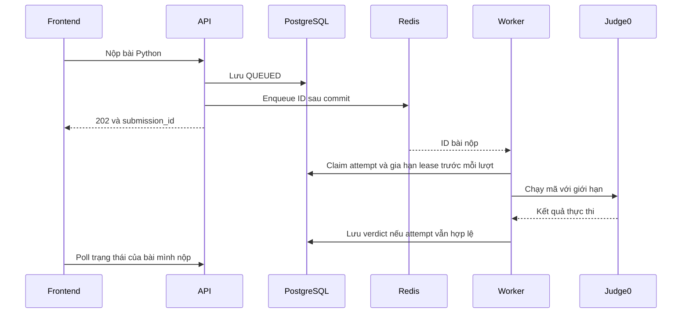

- **Mục đích** Báo cáo tiến độ, kiến trúc và mức sẵn sàng của từng module.
- **Đối tượng đọc** Leader, dev, frontend và QA.
- **Cập nhật lần cuối** 2026-11-25
- **Owner** Backend

# Hiện trạng backend

Backend dùng Java 21, Spring Boot 4.1, JDBC, PostgreSQL 16 và Flyway. Một artifact chạy API và worker riêng. Redis hỗ trợ hàng đợi và quota Sandbox. [Kiến trúc và ranh giới](ARCHITECTURE.md) · [ADR worker](adr/0002-sandbox-worker-and-queue.md)

| Module | Đã triển khai | Tiếp theo |
| --- | --- | --- |
| Khóa học (`content`) | Catalog, điều hướng, tìm bài tập theo slug và API ADMIN biên tập, sắp xếp, xuất bản và thu hồi. Profile dev có 6 bài và 3 bài tập Python. | Nối frontend, duyệt nội dung và UAT trên staging. |
| Tài khoản (`identity`) | Đăng ký email, Argon2id, phiên PostgreSQL, CSRF, hồ sơ, đăng xuất và vai trò. | Hạn mức đăng nhập công khai, xác minh và phục hồi tài khoản, quản lý quyền. |
| Bài tập và runner (`sandbox`) | Đọc bài tập cùng test công khai. Có port `SandboxClient`, Judge0 adapter, giới hạn HTTP và output. | Nghiệm thu Judge0 cô lập, tài nguyên và mạng. |
| Bài nộp (`submission`) | Nộp Python, xem trạng thái, lịch sử và chi tiết theo chủ sở hữu. Worker chấm thử qua stub, có lease, retry và recovery. | Nối frontend qua API tìm bài tập, kiểm tra tải và vận hành trên staging. |
| Hạ tầng HTTP (`common`) | Health, request ID, CORS, whitelist route và Problem Detail. | Cảnh báo và giám sát theo từng tiến trình trên staging. |
| Lộ trình (`learning`) và AI (`tutor`) | Thiết kế trong roadmap. | Làm sau mốc Khóa học và Sandbox. |

[OpenAPI](api/openapi.yaml) · [Hợp đồng Khóa học](COURSE_MODULE.md) · [Kế hoạch Khóa học 6 tuần](COURSE_MODULE_PLAN.md)

## Luồng Sandbox

V7 cấp 16 giới hạn Sandbox ở mọi môi trường. V8 cập nhật lease. PostgreSQL vẫn giữ bài khi mất tín hiệu Redis, còn worker kiểm tra attempt trước khi ghi trạng thái và kết quả. [Triển khai](DEPLOYMENT.md) · [Bảo mật Sandbox](sandbox/SECURITY.md)

Đã chạy Maven `verify` với PostgreSQL 16 và Redis 7, đạt 50 test, không skip. Lint và format đạt. Test migration bao phủ V6 → V8 và V8 → V9, giữ cấu hình Sandbox tùy chỉnh và liên kết bài học với bài tập.

Smoke test mở bài Python, tìm bài tập, đăng nhập, nộp bài và nhận `DONE`, `ACCEPTED`, 100 điểm qua worker với Judge0 HTTP stub. API giới hạn bài nộp theo chủ sở hữu và che input/output của test ẩn. Worker vẫn chấm khi thừa hưởng cùng `SERVER_PORT` với API. Thu hồi khóa ẩn bài học và bài tập, đồng thời giữ lịch sử nộp bài. [Thử nộp bài từ một bài học](ENVIRONMENT_SETUP.md#thử-nộp-bài-từ-một-bài-học)

## Đánh giá

- **Sẵn sàng cho tích hợp nội bộ.** Khóa học có API đọc và quản trị. Sandbox có luồng nộp, chấm và xem kết quả đã kiểm tra với PostgreSQL, Redis và Judge0 HTTP stub.
- **Cần hoàn tất trước pilot.** Xác minh Judge0 thực trên máy cô lập, điều kiện mạng/tài nguyên, tải 30 bài nộp, Redis/worker restart, tích hợp frontend Khóa học, kiểm soát đăng nhập công khai và khả năng restore.
- **Chi phí vận hành chính.** API, worker, PostgreSQL, Redis và Judge0 cần theo dõi riêng. Theo dõi tuổi hàng đợi, số retry, lỗi Judge0 và quyền truy cập trước khi tăng số worker. [Rà soát bộ khung](RELEASE_READINESS.md)
