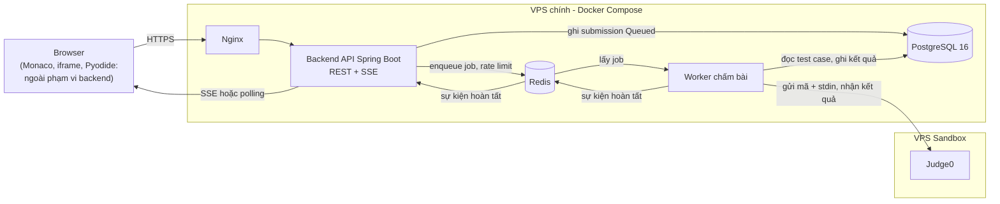
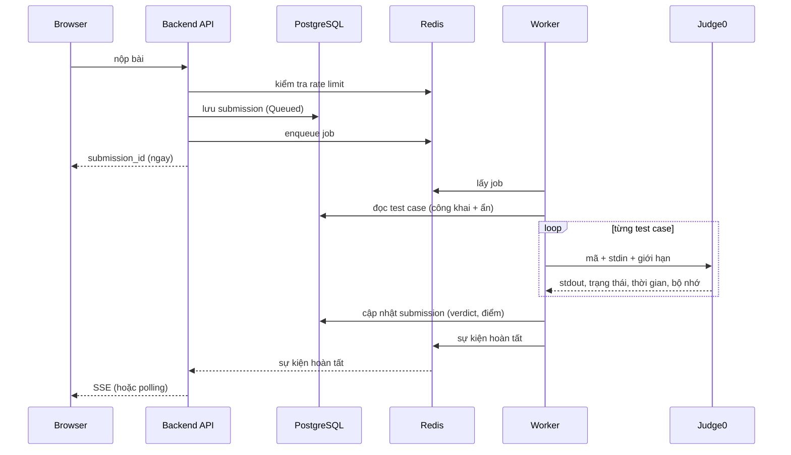

# 01 — Kiến trúc Coding + Sandbox chấm bài (ADR)

## 1. Mục đích và phạm vi

- File này chốt kiến trúc cho tính năng Coding + Sandbox chấm bài: thành phần nào nằm ở đâu, gọi nhau thế nào, quyết định nào đã chốt và vì sao.
- Đây là kiến trúc cùng trạng thái triển khai hiện tại. Redis, API submission/polling, worker tách tiến trình và Judge0 adapter đã có trong mã. Judge0 thật chưa được xác minh; SSE và triển khai cô lập vẫn còn ngoài phạm vi đã kiểm chứng.
- Phạm vi và ngoài phạm vi: xem `00-SCOPE.md`.
- Không lặp chi tiết của file khác: cột bảng và vòng đời trạng thái → `02-DATA-MODEL.md`; ánh xạ verdict, retry, chuẩn hoá output → `03-GRADING-SPEC.md`; endpoint và DTO → `04-API-CONTRACT.md`; checklist bảo mật và runbook Judge0 → `05-SECURITY.md`.
- Quy ước nhãn: `(đề xuất)` = tên/số liệu/cơ chế do tài liệu này đề xuất, nguồn gốc không phải mã hiện có hay đặc tả; `TODO(xác nhận)` = chưa chốt, phải hỏi người trước khi code.

## 2. Tổng quan kiến trúc



| Thành phần | Trạng thái |
| --- | --- |
| Backend API: `content/`, `common/` (Catalog, Security, Health, RequestId, ApiExceptionHandler) | ĐÃ CÓ |
| Backend API: submission, polling, package `submission`, `sandbox` | ĐÃ CÓ; SSE chưa có |
| PostgreSQL 16 (`infra/docker-compose.dev.yml`) | ĐÃ CÓ |
| Redis, worker profile riêng | ĐÃ CÓ (Redis trong compose dev) |
| Judge0 adapter | ĐÃ CÓ; Judge0 thật chưa kiểm thử |
| Nginx, triển khai cách ly Judge0 | CHƯA CÓ |
| Auth/current user | Dùng session hiện có, CSRF và vai trò |

## 3. Ranh giới mạng và tin cậy

| Từ → Tới | Được phép | Ghi chú |
| --- | --- | --- |
| Browser → Nginx → Backend API | Có | HTTPS; REST + SSE; Browser chỉ vào qua Nginx |
| Browser → PostgreSQL / Redis / Worker / Judge0 | Không | Không mở cổng ra ngoài |
| Backend API → PostgreSQL, Redis | Có | Ghi submission, enqueue, rate limit, nhận sự kiện hoàn tất |
| Worker → PostgreSQL, Redis | Có | Đọc test case, ghi kết quả, lấy job, phát sự kiện |
| **Worker → Judge0** | **Có, duy nhất** | Chỉ worker được gọi Judge0 |
| Backend API → Judge0 | Không | API không bao giờ chạm sandbox |
| Judge0 → Internet | Không | Bị chặn ra Internet |
| Judge0 → VPS chính (API, Worker, PG, Redis) | Không | Không gọi ngược; vì vậy không dùng `callback_url` |
| Mã người dùng → mạng | Không | Tắt mạng trong sandbox; chi tiết `05-SECURITY.md` |

- Judge0 **không public**: chỉ nhận kết nối từ worker. Cơ chế chặn cụ thể (firewall, allowlist) ghi ở `05-SECURITY.md`.
- VPS Sandbox chỉ chạy Judge0; không chứa dữ liệu nghiệp vụ hay khoá bí mật của hệ thống chính.
- Thông tin xác thực gọi Judge0 (nếu có) chỉ nằm ở biến môi trường của worker, không vào mã nguồn, log hay response.

## 4. Luồng 3 pha (UC10)



| Pha | Ai làm | Đọc / ghi gì | Kết quả |
| --- | --- | --- | --- |
| 1. Tiếp nhận (non-blocking) | Backend API | Kiểm tra quyền, kích thước mã; Redis: rate limit, enqueue; PG: ghi submission `Queued` | Trả `submission_id` ngay |
| 2. Thực thi | Worker | Redis: lấy job; PG: đọc test case; Judge0: chạy từng test | Kết quả thô từng test |
| 3. Tổng hợp | Worker, rồi Backend API | PG: cập nhật submission; Redis: sự kiện hoàn tất; API → Browser qua SSE/polling | Verdict và điểm hiển thị cho người học |

Quy tắc chấm (chuẩn hoá, ánh xạ verdict, điểm) nằm ở `03-GRADING-SPEC.md`, không lặp ở đây.

## 5. Các quyết định kiến trúc (ADR)

### ADR-A: Redis cho queue và rate limit, PostgreSQL là source of truth

- **Bối cảnh**: báo cáo dùng Redis cho hàng đợi và rate limit; compose dev hiện chỉ có PostgreSQL.
- **Quyết định**: Redis giữ hàng đợi job chấm bài và bộ đếm rate limit. PostgreSQL giữ trạng thái submission và mọi kết quả. Có job quét lại các bài kẹt `QUEUED`/`RUNNING` (ngưỡng thời gian: `TODO(xác nhận)`).
- **Lý do**: không chặn request khi nộp bài; bài nộp không mất dù worker chậm (NF-02); dữ liệu quan trọng không phụ thuộc Redis.
- **Hệ quả**: thêm Redis vào `infra/docker-compose.dev.yml` (task ở `07-TASKS.md`). Nếu Redis mất dữ liệu: **mất** các job đang chờ trong queue và bộ đếm rate limit; **không mất** submission vì đã nằm ở PG; job quét lại đọc PG và enqueue lại. Bỏ Redis để dùng PG `SKIP LOCKED` là lệch đặc tả, xem mục 9.
- **Trạng thái**: Đã chốt.

### ADR-B: Judge0 không gọi ngược, worker chủ động lấy kết quả

- **Bối cảnh**: Judge0 bị chặn truy cập ngược vào VPS chính; chỉ worker được gọi Judge0.
- **Quyết định**: **KHÔNG dùng `callback_url`**. Worker gửi `wait=false` và poll token; Judge0 không public. Đây mới là implementation choice, chưa được đo/kiểm chứng với Judge0 thật.
- **Lý do**: callback đòi Judge0 mở kết nối về máy chính, phá ranh giới mạng ở mục 3.
- **Hệ quả**: worker giữ kết nối hoặc vòng poll tới Judge0; độ trễ và số kết nối ảnh hưởng NF-01 (mục 8). Chi tiết cơ chế ở `03-GRADING-SPEC.md`.
- **Trạng thái**: Poll được dùng trong mã; kết quả spike Judge0 thật còn thiếu.

### ADR-C: Trả kết quả qua SSE, polling là fallback

- **Bối cảnh**: báo cáo yêu cầu SSE đẩy kết quả chấm; polling khi SSE gián đoạn.
- **Quyết định**: SSE nằm ở **Backend API**, không ở worker. Worker chỉ báo hoàn tất qua Redis; cơ chế cụ thể: Redis Pub/Sub với kênh `submission:done` (đề xuất), `TODO(xác nhận)`. API nhận sự kiện rồi đẩy xuống kết nối SSE tương ứng. Endpoint polling ở `04-API-CONTRACT.md`.
- **Lý do**: worker không phải giữ kết nối tới trình duyệt; tách trách nhiệm API và worker.
- **Hệ quả**:
  - SSE chỉ là **thông báo**, không là nguồn dữ liệu: nguồn đúng luôn là PG.
  - Pub/Sub không lưu sự kiện: client bỏ lỡ sự kiện (reconnect, API restart) phải đọc trạng thái từ PG.
  - Nếu chạy nhiều instance API: sự kiện có thể tới instance không giữ kết nối của client đó. Số instance chưa biết, `TODO(xác nhận)`; thiết kế phải cho mỗi instance nhận sự kiện và chỉ đẩy cho kết nối mình đang giữ.
- **Trạng thái**: Đề xuất.

### ADR-D: Package `submission` và `sandbox`, Judge0 sau một adapter

- **Bối cảnh**: repo tổ chức package theo feature (`content`, `common`); cần thay được Judge0 bằng Piston (dự phòng) hoặc stub trong CI.
- **Quyết định**: package `submission` và `sandbox` nằm cạnh `content`. Judge0 client sau interface `SandboxClient`; `submission` dùng `sandbox`, `sandbox` không phụ thuộc `submission`; `content` không phụ thuộc `submission`.
- **Lý do**: giữ convention hiện có; cô lập phần rủi ro cao (R7); đáp ứng NF-07 (tách sandbox khỏi phần còn lại).
- **Hệ quả**: CI dùng HTTP stub cho adapter và fake client cho grading service, không cần Judge0 thật. Cấu trúc ở mục 6.
- **Trạng thái**: Đã triển khai một phần; chưa có kiểm thử tích hợp đầy đủ từ queue đến worker.

### ADR-E: Worker đóng gói thế nào

- **Bối cảnh**: báo cáo chỉ nói "Worker chấm bài" chạy trên VPS chính, chưa nói cách đóng gói.
- **Quyết định (đề xuất)**: cùng codebase Spring Boot, cùng artifact, chạy thành **tiến trình riêng** bằng một profile (tên profile `worker` là đề xuất). Không tách repo hay module Maven riêng ở MVP.
- **Lý do**: tái dùng `JdbcClient`, cấu hình, convention; worker chậm hoặc chết không kéo API chết theo; scale độc lập (NF-07, NF-02).
- **Hệ quả**: hai container từ một image trên VPS chính. Chỉ một trong hai tiến trình được chạy Flyway migration (chọn tiến trình nào: đề xuất API). Phương án thay thế bị loại: cùng tiến trình (worker chậm ảnh hưởng API); module tách (tốn công cho nhóm nhỏ).
- **Trạng thái**: Đã chọn worker profile riêng; chưa nghiệm thu triển khai vận hành.

### ADR-F: Auth và `CurrentUser`

- **Bối cảnh**: nộp bài cần đăng nhập (Học viên trở lên). Auth chưa có và `SecurityConfiguration` đang chặn mọi method ghi.
- **Quyết định**: nộp bài chỉ phụ thuộc một abstraction lấy người dùng hiện tại, `CurrentUser`. Trong lúc chờ auth, `CurrentUser` stub **chỉ tồn tại ở profile `dev`**. Auth thật thay stub mà không đổi mã `submission`.
- **Lý do**: không chặn việc làm sandbox; giữ chỗ cho cả hai hướng.
- **Hệ quả**: stub tuyệt đối không bật ở profile khác. `SecurityConfiguration` chỉ mở **đúng các route** được nêu trong task (xem `05-SECURITY.md`, `07-TASKS.md`); không nới rộng ngoài đó.
- **Trạng thái**: Đã chọn session hiện có + CSRF và vai trò LEARNER trở lên cho submission.

### ADR-G: Bí mật không rời server

- **Bối cảnh**: test ẩn và lời giải tham khảo phải không lộ cho người học.
- **Quyết định**: `expected_output` của test ẩn và lời giải tham khảo **không xuất hiện** trong DTO, response hay log. Chỉ worker đọc test ẩn đầy đủ. API đọc test case bằng truy vấn không chọn các cột này.
- **Lý do**: lộ dữ liệu này phá hoàn toàn việc chấm bài.
- **Hệ quả**: repository tách hai đường đọc: một cho API (chỉ cột công khai) và một cho worker (đầy đủ); tên cụ thể là đề xuất. Log của worker không in `expected_output` hay stdin của test ẩn. Cần test khẳng định điều này (`06-TEST-PLAN.md`).
- **Trạng thái**: Đã chốt.

### Quyết định kèm theo

- **Giới hạn sandbox** (thời gian, bộ nhớ, số tiến trình, kích thước mã, số bài chờ) đọc từ bảng cấu hình mà admin chỉnh được; **không hard-code**. Ai đọc: backend khi nhận bài, worker khi chạy. Đọc mỗi lần chấm hay cache: `TODO(xác nhận)`. Cấu trúc bảng ở `02-DATA-MODEL.md`.
- **Hint ladder** ngoài phạm vi, nhưng module `submission` phải sẵn sàng cung cấp số lần nộp chưa đạt và cờ đã Accepted theo (user, exercise).

## 6. Cấu trúc package đề xuất

Toàn bộ tên dưới đây trong `submission/` và `sandbox/` là **(đề xuất)**; `common/` và `content/` là ĐÃ CÓ.

```
backend/src/main/java/vn/edu/codelearn/platform/
├── common/              # ĐÃ CÓ: SecurityConfiguration, RequestIdFilter, ApiExceptionHandler...
├── content/             # ĐÃ CÓ: Catalog*
├── submission/          # CHƯA CÓ
│   ├── SubmissionController / Service / Repository / Views
│   ├── queue/           # enqueue và nhận job qua Redis
│   ├── worker/          # vòng lặp chấm bài (profile `worker`)
│   └── events/          # phát và nhận sự kiện hoàn tất
└── sandbox/             # CHƯA CÓ
    ├── SandboxClient    # interface adapter
    ├── judge0/          # cài đặt gọi Judge0
    └── stub/            # bản giả cho CI và test
```

| Phần | Vai trò | Phụ thuộc |
| --- | --- | --- |
| `submission` (API) | Nhận bài, rate limit, ghi PG, enqueue, SSE/polling | `sandbox` không dùng ở nhánh API; đọc dữ liệu bài tập từ `content` |
| `submission/worker` | Lấy job, đọc test, gọi `SandboxClient`, tổng hợp, ghi PG | `sandbox` |
| `sandbox` | Gửi mã + stdin + giới hạn, nhận stdout, trạng thái, thời gian, bộ nhớ | Không phụ thuộc package nghiệp vụ nào |
| `CurrentUser` | Lấy người dùng hiện tại; stub ở `dev` | Đặt ở `common/` (đề xuất) |

- Interface `SandboxClient` chỉ biết khái niệm engine: nhận mã, stdin, giới hạn; trả stdout, trạng thái, thời gian, bộ nhớ. Không chứa khái niệm verdict, điểm hay submission.
- Ánh xạ trạng thái engine sang verdict thuộc về worker (`03-GRADING-SPEC.md`), không thuộc `sandbox`.

## 7. Độ tin cậy và khôi phục

| Tình huống | Điều gì xảy ra | Xử lý |
| --- | --- | --- |
| Redis mất dữ liệu | Mất job đang chờ và bộ đếm rate limit | Submission còn ở PG; job quét lại enqueue lại bài `QUEUED`/`RUNNING` kẹt; rate limit đếm lại từ đầu (chấp nhận) |
| Worker chết giữa chừng | Bài kẹt `RUNNING`, không ai hoàn tất | Job quét lại phát hiện và chấm lại; chấm lại không được sinh kết quả trùng (xem `02` và `03`) |
| Judge0 down | Worker không gọi được engine | Bài chuyển trạng thái lỗi hệ thống, retry có giới hạn; chi tiết `03-GRADING-SPEC.md` |
| Backend restart khi có SSE | Kết nối SSE đứt | Client reconnect hoặc polling; trạng thái lấy từ PG |
| Worker xong nhưng API chưa nhận sự kiện | Kết quả đã ở PG | Polling thấy kết quả; SSE không là nguồn dữ liệu (ADR-C) |

## 8. Ảnh hưởng của yêu cầu phi chức năng

| Yêu cầu | Tác động tới quyết định | Ghi chú |
| --- | --- | --- |
| NF-01 / M3: mã đơn giản phản hồi khoảng 3 giây | ADR-B (poll hay `wait=true`), ADR-E | Báo cáo chạy test lần lượt nên độ trễ cộng dồn theo số test; song song hoá hay không: `TODO(xác nhận)`. Đo ở spike Judge0, không bịa số |
| NF-02: 30 bài nộp đồng thời không mất bài | ADR-A (PG là nguồn đúng, job quét lại), ADR-E (worker scale riêng) | Số 30 là mục tiêu đề xuất của báo cáo: `TODO(xác nhận)` |
| NF-04: 7 lớp bảo vệ sandbox (Bảng 5.8) | Kiến trúc đảm nhiệm: tách VPS, cô lập mạng, chỉ worker gọi Judge0, rate limit (Redis) | Các lớp còn lại (cô lập mỗi lần chạy, tắt mạng, giới hạn tài nguyên, quyền tối thiểu) → `05-SECURITY.md` |
| NF-07: tách sandbox và module AI | ADR-D (adapter), ADR-E (tiến trình riêng) | Module AI ngoài phạm vi |

Rủi ro liên quan: R3 (sandbox bị lạm dụng), R7 (Judge0 khó cài/vận hành → spike tuần 1–2).

## 9. Phương án dự phòng và điều kiện kích hoạt

Đây là phương án dự phòng, **không phải quyết định**.

| Phương án | Điều kiện kích hoạt | Phần tài liệu phải sửa |
| --- | --- | --- |
| Bản dịch vụ của Judge0 | Spike tuần 1–2 cho thấy tự host Judge0 không vận hành được (R7) | Mục 2 và 3 (ranh giới mạng đổi), ADR-B, `05-SECURITY.md` |
| Piston | Sau khi kiểm tra tình trạng bảo trì hiện tại và Judge0 không dùng được | ADR-D (thêm cài đặt `SandboxClient`), `03-GRADING-SPEC.md` (ánh xạ trạng thái), `05-SECURITY.md` |
| PG `SKIP LOCKED` thay Redis | Quyết định bỏ Redis để giảm thành phần. **Lệch đặc tả báo cáo**, phải ghi rõ | Mục 2, 3, 4, ADR-A, ADR-C (thay Pub/Sub), mục 7; rate limit phải chuyển chỗ khác; `02-DATA-MODEL.md` |

## 10. Điểm cần xác nhận

- `TODO(xác nhận)`: Worker lấy kết quả từ Judge0 bằng poll hay `wait=true` (ADR-B; chi tiết ở `03`).
- `TODO(xác nhận)`: Worker đóng gói thế nào: tiến trình riêng cùng codebase (đề xuất) hay phương án khác (ADR-E).
- `TODO(xác nhận)`: Cơ chế worker báo hoàn tất cho backend: Redis Pub/Sub, kênh `submission:done` (đề xuất) (ADR-C).
- `TODO(xác nhận)`: Số instance Backend API và cách xử lý sự kiện giữa các instance (ADR-C).
- `TODO(xác nhận)`: Giới hạn sandbox đọc từ bảng config mỗi lần chấm hay cache.
- `TODO(xác nhận)`: Auth thật có thuộc phạm vi tính năng này không (ADR-F).
- `TODO(xác nhận)`: Mục tiêu 30 bài nộp đồng thời (NF-02) có giữ nguyên không.
- `TODO(xác nhận)`: Ngưỡng thời gian để job quét lại coi bài là kẹt; chạy test song song hay tuần tự (mục 8).
