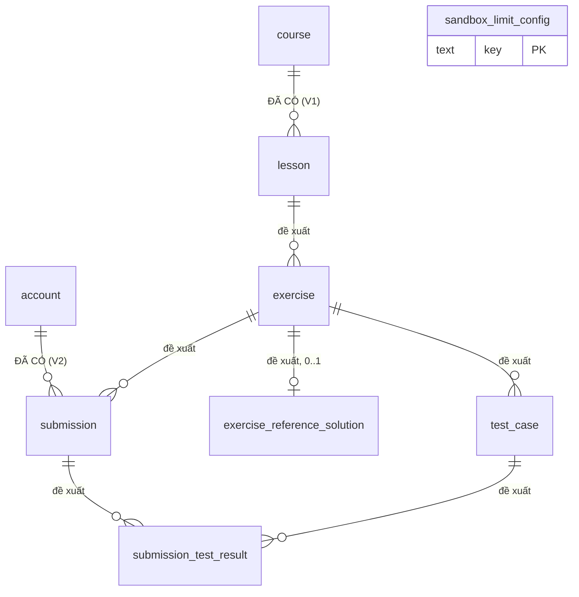

# 02-DATA-MODEL: Mô hình dữ liệu Coding + Sandbox chấm bài

## 1. Mục đích và phạm vi

- File này là **thiết kế đề xuất**. Chưa có migration nào cho sandbox, mọi bảng mới đều là đề xuất.
- Phạm vi dữ liệu là PostgreSQL 16 cho MVP: Python, chấm so khớp stdin/stdout qua Judge0. Phạm vi sản phẩm xem `00-SCOPE.md`.
- Không lặp ánh xạ verdict và chuẩn hoá output (xem `03-GRADING-SPEC.md`), không lặp endpoint và DTO (xem `04-API-CONTRACT.md`).
- Hàng đợi và rate limit nằm ở Redis. File này chỉ nêu ranh giới ở mục 2 và 6.

## 2. Nguyên tắc thiết kế dữ liệu

- PostgreSQL là source of truth cho exercise, test case, submission, config. Redis chỉ giữ hàng đợi job và bộ đếm rate limit, không giữ dữ liệu không thể dựng lại từ PG.
- Truy cập bằng `JdbcClient`, không JPA. Mọi truy vấn viết SQL tường minh, liệt kê cột, cấm `SELECT *` trên bảng có cột bí mật.
- Bí mật không rời server: `expected_output` của test ẩn và lời giải tham khảo không xuất hiện trong truy vấn của API, DTO, response hay log.
- Không hard-code giới hạn sandbox. Mọi giới hạn đọc từ bảng config (AD-03).
- Chỉ thêm migration `V<n>` mới, không sửa `V1__create_catalog.sql`.
- Tên bảng/cột ở số ít, snake_case, theo kiểu `course`, `lesson` hiện có.
- Mọi kiểu/tên ghi `<...>` là chỗ chưa xác nhận, xem mục 9.

## 3. Sơ đồ quan hệ

- **ĐÃ CÓ (V1):** `course`, `lesson`.
- **ĐÃ CÓ (V2):** `account`, dùng làm chủ thể của `submission`.
- **ĐỀ XUẤT (mới):** `exercise`, `exercise_reference_solution`, `test_case`, `submission`, `submission_test_result`, `sandbox_limit_config`.
- `submission.user_id` tham chiếu `account.id` đã có trong V2.



- `sandbox_limit_config` độc lập, không có quan hệ.
- `submission.user_id` là FK tới `account.id`; không tạo bảng người dùng riêng.

## 4. Đặc tả từng bảng (tất cả ĐỀ XUẤT)

Quy ước chung (đề xuất):
- Khóa chính tự sinh mới: `bigint GENERATED ALWAYS AS IDENTITY`.
- Thời điểm: `timestamptz`.
- Kiểu cột tham chiếu tới `lesson` là `bigint`; `submission.user_id` là `bigint` tham chiếu `account.id`.

### 4.1 `exercise`

| Cột | Kiểu | Null | Ghi chú |
|---|---|---|---|
| `id` | bigint identity | NOT NULL | PK |
| `lesson_id` | `<kiểu PK lesson>` | NOT NULL | FK → `lesson` |
| `title` | text | NOT NULL | |
| `language` | text | NOT NULL | MVP: `python` |
| `difficulty` | text | NOT NULL | Tập giá trị: TODO |
| `statement_md` | text | NOT NULL | Đề bài Markdown |
| `starter_code` | text | NOT NULL | Có thể rỗng `''` |
| `grading_type` | text | NOT NULL | Xem CHECK |
| `max_score` | integer | NOT NULL | |
| `created_at`, `updated_at` | timestamptz | NOT NULL | `DEFAULT now()` |

- **Khóa/ràng buộc:**
  - `PRIMARY KEY (id)`.
  - `FOREIGN KEY (lesson_id)` tham chiếu khóa chính `lesson`, `ON DELETE RESTRICT`.
  - `CHECK (max_score > 0)`.
  - `CHECK (grading_type IN ('OUTPUT_MATCH','UNIT_TEST','DOM'))`.
- MVP chỉ dùng `OUTPUT_MATCH`. `UNIT_TEST` (SB-10) và `DOM` (SB-09) chỉ để chỗ mở rộng, chưa có logic.
- **Không có cột xuất bản riêng.** Trạng thái xuất bản lấy từ `lesson` và `course` (mục 7).
- **Cột bí mật:** không có. Toàn bộ bảng đọc được qua API sau khi qua điều kiện xuất bản.

### 4.2 `exercise_reference_solution`

| Cột | Kiểu | Null | Ghi chú |
|---|---|---|---|
| `id` | bigint identity | NOT NULL | PK |
| `exercise_id` | bigint | NOT NULL | FK → `exercise(id)`, `ON DELETE CASCADE` |
| `language` | text | NOT NULL | |
| `source_code` | text | NOT NULL | Lời giải tham khảo |
| `created_at` | timestamptz | NOT NULL | `DEFAULT now()` |

- **Ràng buộc:** `UNIQUE (exercise_id)`, mỗi bài một lời giải.
- **TUYỆT ĐỐI không lộ ra API:** toàn bộ bảng, kể cả `source_code`.
- Không repository của API nào được `JOIN` hoặc `SELECT` bảng này.

### 4.3 `test_case`

| Cột | Kiểu | Null | Ghi chú |
|---|---|---|---|
| `id` | bigint identity | NOT NULL | PK |
| `exercise_id` | bigint | NOT NULL | FK → `exercise(id)`, `ON DELETE CASCADE` |
| `position` | integer | NOT NULL | Thứ tự chạy, bắt đầu từ 1 |
| `stdin` | text | NOT NULL | Có thể rỗng |
| `expected_output` | text | NOT NULL | **Bí mật nếu `is_public = false`** |
| `is_public` | boolean | NOT NULL | `DEFAULT false` (mặc định an toàn: ẩn) |
| `weight` | integer | NOT NULL | Trọng số điểm |

- **Ràng buộc:**
  - `UNIQUE (exercise_id, position)`.
  - `CHECK (weight > 0)`, `CHECK (position > 0)`.
  - Index `(exercise_id)` do UNIQUE ở trên đã phủ.
- **TUYỆT ĐỐI không lộ ra API:** `expected_output` của dòng có `is_public = false`. Dòng `is_public = true` thì `stdin`, `expected_output` được hiện.
- Đề xuất tạo view `test_case_public` chỉ gồm `id`, `exercise_id`, `position`, `stdin`, `expected_output`, `weight` của dòng `is_public = true`. API đọc test qua view này, không đọc bảng gốc.
- Với test ẩn, API chỉ được biết `id`, `position`, `weight` hoặc cờ Passed/Failed từ `submission_test_result`, không đọc `stdin` của test ẩn.

### 4.4 `submission`

| Cột | Kiểu | Null | Ghi chú |
|---|---|---|---|
| `id` | bigint identity | NOT NULL | PK, trả cho client là `submission_id` |
| `user_id` | bigint | NOT NULL | FK → `account(id)`, `ON DELETE RESTRICT` |
| `exercise_id` | bigint | NOT NULL | FK → `exercise(id)`, `ON DELETE RESTRICT` |
| `language` | text | NOT NULL | |
| `source_code` | text | NOT NULL | Kích thước lớn: TODO |
| `status` | text | NOT NULL | Trạng thái xử lý, mục 5 |
| `verdict` | text | NULL | NULL cho tới khi `status = 'DONE'` |
| `score` | numeric(7,2) | NULL | Cùng điều kiện với `verdict` |
| `time_ms` | integer | NULL | Tổng hợp cho cả bài nộp (cách tổng hợp: `03-GRADING-SPEC.md`) |
| `memory_kb` | integer | NULL | Như trên |
| `error_message` | text | NULL | Thông báo Compile Error / lỗi thực thi của mã người học |
| `attempt_count` | integer | NOT NULL | `DEFAULT 0` |
| `created_at` | timestamptz | NOT NULL | `DEFAULT now()` |
| `status_updated_at` | timestamptz | NOT NULL | `DEFAULT now()`, cập nhật mỗi lần đổi `status` |
| `finished_at` | timestamptz | NULL | |

- **Ràng buộc:**
  - `CHECK (status IN ('QUEUED','RUNNING','DONE','FAILED'))`. Ngoài QUEUED/RUNNING, hai trạng thái còn lại là **đề xuất**.
  - `CHECK (verdict IS NULL OR verdict IN ('ACCEPTED','WRONG_ANSWER','TIME_LIMIT','MEMORY_LIMIT','RUNTIME_ERROR','COMPILE_ERROR'))`. Cách ghi giá trị là đề xuất, ánh xạ từ Judge0 xem `03-GRADING-SPEC.md`.
  - `CHECK ((status = 'DONE') = (verdict IS NOT NULL))`.
  - `CHECK (attempt_count >= 0)`, `CHECK (score IS NULL OR score >= 0)`.
- Điểm tính ở worker, lưu vào `score`. Công thức ở `03-GRADING-SPEC.md`.
- **Cột nhạy cảm:** `source_code` chỉ trả cho chính chủ bài nộp (kiểm tra `user_id`). Không đưa vào danh sách lịch sử.
- Không log `source_code` ở mức INFO trở lên (đề xuất).
- Hiện chưa có cột bí mật của hệ thống trong bảng này.

### 4.5 `submission_test_result`

| Cột | Kiểu | Null | Ghi chú |
|---|---|---|---|
| `id` | bigint identity | NOT NULL | PK |
| `submission_id` | bigint | NOT NULL | FK → `submission(id)`, `ON DELETE CASCADE` |
| `test_case_id` | bigint | NOT NULL | FK → `test_case(id)`, `ON DELETE RESTRICT` |
| `passed` | boolean | NOT NULL | Passed/Failed |
| `verdict` | text | NOT NULL | Cùng tập giá trị 6 verdict; test đạt ghi `ACCEPTED` |
| `time_ms` | integer | NULL | Theo từng test |
| `memory_kb` | integer | NULL | Theo từng test |
| `actual_output` | text | NULL | **Chỉ ghi cho test công khai**; test ẩn luôn NULL |

- **Ràng buộc:**
  - `UNIQUE (submission_id, test_case_id)`.
  - `CHECK (passed = (verdict = 'ACCEPTED'))`.
- Test công khai: API ghép `stdin`, `expected_output` (từ view `test_case_public`) với `actual_output`.
- Test ẩn: API chỉ nhận `passed`, `time_ms`, `memory_kb`. Không bao giờ đọc `actual_output`.
- Worker không ghi `actual_output` cho test ẩn, vì output khớp chính là `expected_output`.
- Chi tiết khi Compile Error (dừng chấm sớm) và cách ghi các test chưa chạy: xem `03-GRADING-SPEC.md`.

### 4.6 `sandbox_limit_config`

| Cột | Kiểu | Null | Ghi chú |
|---|---|---|---|
| `key` | text | NOT NULL | PK |
| `value_int` | bigint | NOT NULL | |
| `unit` | text | NOT NULL | Ví dụ `ms`, `kb`, `bytes`, `count`, `seconds` |
| `updated_at` | timestamptz | NOT NULL | `DEFAULT now()` |

- **Ràng buộc:** `CHECK (key IN (...))` theo danh sách key bên dưới, `CHECK (value_int > 0)`.
- **Danh sách key (đề xuất):**
  - `submit_rate_max`, `submit_rate_window_seconds` (tần suất nộp)
  - `code_size_max_bytes` (kích thước mã)
  - `time_limit_ms` (thời gian chạy)
  - `memory_limit_kb` (bộ nhớ)
  - `max_processes` (số tiến trình)
  - `max_pending_per_user` (số bài nộp đang chờ tối đa mỗi user)
- **Không điền giá trị mặc định** trong migration. Thiếu key thì ứng dụng báo lỗi cấu hình rõ ràng, không tự bịa số (giá trị: TODO mục 9).
- Bảng này chỉ lưu giá trị. Việc áp rate limit và đếm hàng đợi thực hiện ở Redis, ngoài phạm vi file này.
- Admin sửa qua trang AD-03. Chi tiết endpoint ở `04-API-CONTRACT.md`.
- Không có cột bí mật. Chỉ admin được ghi, các vai trò khác không đọc.

## 5. Vòng đời trạng thái của `submission`

Trạng thái (đề xuất, ngoài QUEUED/RUNNING):

| `status` | Ý nghĩa | `verdict` |
|---|---|---|
| `QUEUED` | Đã lưu, đã (hoặc sắp) đẩy job vào Redis | NULL |
| `RUNNING` | Worker đang chấm | NULL |
| `DONE` | Chấm xong, có verdict | NOT NULL |
| `FAILED` | Lỗi hệ thống (Judge0/worker), hết lượt thử lại | NULL |

Chuyển trạng thái hợp lệ và người được đổi:

| Từ → Đến | Ai đổi | Điều kiện |
|---|---|---|
| (mới) → `QUEUED` | Tiếp nhận (backend API) | INSERT cùng lúc với đẩy job; `attempt_count = 0` |
| `QUEUED` → `RUNNING` | Worker | `UPDATE ... WHERE id = :id AND status = 'QUEUED'`, tăng `attempt_count` |
| `RUNNING` → `DONE` | Worker | Ghi `verdict`, `score`, `time_ms`, `memory_kb`, `finished_at` |
| `RUNNING` → `QUEUED` | Job quét bài kẹt | Kẹt quá ngưỡng và còn lượt thử lại |
| `QUEUED`/`RUNNING` → `FAILED` | Worker hoặc job quét | Hết lượt thử lại |

- Mọi chuyển trạng thái dùng `UPDATE` có điều kiện `status` hiện tại để tránh tranh chấp giữa các worker. Kiểm tra `rowCount = 1` mới được xử lý tiếp.
- `status_updated_at` được cập nhật ở mỗi chuyển trạng thái.
- `DONE` và `FAILED` là trạng thái cuối, không đổi nữa.
- **`attempt_count` tăng +1** mỗi lần worker nhận bài (`QUEUED` → `RUNNING`), không tăng khi job quét đưa về `QUEUED`.
- **Job quét bài kẹt** dựa trên `status_updated_at`:
  - `status IN ('QUEUED','RUNNING')` và `status_updated_at < now() - <ngưỡng>` thì coi là kẹt.
  - Ngưỡng và số lần thử lại tối đa: TODO mục 9.
  - Bài kẹt còn lượt thì đưa về `QUEUED` và đẩy lại job. Hết lượt thì chuyển `FAILED`.
- Ranh giới Redis: mất job trong Redis thì bài vẫn còn `QUEUED` trong PG và sẽ được job quét nhặt lại.

## 6. Index và truy vấn bắt buộc

```sql
-- Hint ladder, lịch sử theo (user, exercise)
CREATE INDEX idx_submission_user_exercise_created
    ON submission (user_id, exercise_id, created_at);
-- Job quét bài kẹt
CREATE INDEX idx_submission_stuck
    ON submission (status_updated_at) WHERE status IN ('QUEUED','RUNNING');
-- Đếm bài đang chờ của user
CREATE INDEX idx_submission_pending_user
    ON submission (user_id) WHERE status IN ('QUEUED','RUNNING');
-- Kết quả theo bài nộp
CREATE INDEX idx_submission_test_result_submission
    ON submission_test_result (submission_id);
```

**Số lần nộp chưa đạt + cờ đã Accepted** (contract cho giai đoạn AI, không kèm logic gợi ý):

```sql
SELECT count(*) FILTER (WHERE status = 'DONE' AND verdict <> 'ACCEPTED') AS failed_count,
       COALESCE(bool_or(verdict = 'ACCEPTED'), false)                    AS has_accepted
FROM submission
WHERE user_id = :userId AND exercise_id = :exerciseId;
```

- "Chưa đạt" là `status = 'DONE'` và `verdict <> 'ACCEPTED'`. Bài `FAILED` (lỗi hệ thống) **không** tính (đề xuất).

**Lịch sử nộp có phân trang** (keyset, tối đa 50, không chọn `source_code`):

```sql
SELECT id, exercise_id, status, verdict, score, time_ms, memory_kb, created_at
FROM submission
WHERE user_id = :userId AND exercise_id = :exerciseId
  AND (created_at, id) < (:cursorCreatedAt, :cursorId)  -- bỏ điều kiện này ở trang đầu
ORDER BY created_at DESC, id DESC
LIMIT :limit;  -- :limit = LEAST(yêu cầu, 50), kẹp ở tầng repository
```

**Quét bài kẹt:**

```sql
SELECT id, status, attempt_count
FROM submission
WHERE status IN ('QUEUED','RUNNING')
  AND status_updated_at < now() - make_interval(secs => :thresholdSeconds)
ORDER BY status_updated_at
LIMIT :batch;
```

**Lấy test case cho worker** (đọc đủ test, chỉ worker được gọi):

```sql
SELECT id, position, stdin, expected_output, weight, is_public
FROM test_case
WHERE exercise_id = :exerciseId
ORDER BY position;
```

## 7. Quy tắc truy cập dữ liệu

| Dữ liệu | API trình duyệt | Worker | Không bao giờ ra khỏi server |
|---|---|---|---|
| `exercise` (mọi cột) | Đọc, sau điều kiện xuất bản | Đọc | |
| `test_case` qua view `test_case_public` | Đọc | | |
| `test_case.stdin` của test ẩn | | Đọc | Có |
| `test_case.expected_output` của test ẩn | | Đọc | **Có** |
| `exercise_reference_solution` (mọi cột) | | | **Có** |
| `submission` trừ `source_code`, của chính chủ | Đọc | Đọc/ghi | |
| `submission.source_code`, của chính chủ | Đọc (chi tiết) | Đọc | |
| `submission_test_result` trừ `actual_output` | Đọc | Ghi | |
| `submission_test_result.actual_output` (test công khai) | Đọc | Ghi | |
| `sandbox_limit_config` | Không | Đọc | |

- Hệ quả schema/truy vấn:
  - Repository của API không chọn `test_case.expected_output` từ bảng gốc, chỉ đọc qua view `test_case_public`.
  - Repository của API không chạm `exercise_reference_solution`.
  - Truy vấn worker và log không in giá trị tham số nếu nó là `expected_output`.
- Gợi ý (đề xuất): tạo role DB riêng cho API và cho worker. API không có quyền `SELECT` trên `exercise_reference_solution` và `test_case` gốc.
- Cấu hình giới hạn: chỉ admin ghi (AD-03). Phần quyền hạn nằm ở `04-API-CONTRACT.md`.
- **Quy tắc 404 cho nội dung chưa xuất bản:** `exercise` không có cột xuất bản riêng, nên mọi truy vấn đọc `exercise` cho API đi qua join:

```sql
SELECT e.<các cột cần>
FROM exercise e
JOIN lesson l ON l.<pk lesson> = e.lesson_id
JOIN course c ON c.<pk course> = l.<fk tới course>
WHERE e.id = :exerciseId
  AND <điều kiện xuất bản lesson của V1>
  AND <điều kiện xuất bản course của V1>;
```

- Không có hàng nào thì trả 404, cùng cách với `content` hiện tại.
- Nộp bài vào exercise chưa xuất bản cũng phải trả 404 ở bước tiếp nhận.
- Tên cột và điều kiện xuất bản trong V1: TODO mục 9.

## 8. Kế hoạch migration

Số thứ tự và tên file là **đề xuất**. Không sửa `V1__create_catalog.sql`.

| File (đề xuất) | Nội dung | Thứ tự / phụ thuộc |
|---|---|---|
| `V3__create_exercise.sql` | `exercise`, `exercise_reference_solution`, `test_case`, view `test_case_public` | Sau V2 identity, cần PK `lesson` từ V1 |
| `V4__create_submission.sql` | `submission`, `submission_test_result`, 4 index ở mục 6 | Sau V3; `user_id` tham chiếu `account.id` |
| `V5__create_sandbox_limit_config.sql` | `sandbox_limit_config`, không seed giá trị | Sau V4 |

- **Seed `dev`:** `backend/src/main/resources/db/demo/R__seed_demo_exercises.sql`, repeatable, chỉ profile `dev`, theo mẫu `db/demo/R__seed_demo_catalog.sql`.
  - Dữ liệu: vài bài Python cơ bản (ví dụ in ra, nhập số, tính tổng), mỗi bài có cả test công khai và test ẩn, kèm một lời giải tham khảo.
- Gắn vào lesson demo có sẵn qua `course.slug` và `lesson.slug`.
  - Seed giá trị `sandbox_limit_config` cho `dev`: TODO, vì chưa có số liệu.
- **Fixture SQL cho test tích hợp:** `backend/src/test/resources/sandbox-fixtures.sql`, cùng chỗ với fixture hiện có của repo.
  - Chỉ chạy khi có `TEST_DB_URL`.
  - Cần các tình huống: exercise của lesson/course đã xuất bản, của lesson nháp, của course nháp (kỳ vọng 404), test ẩn không lộ, bài kẹt `QUEUED`/`RUNNING`, user có 0/1/nhiều lần nộp chưa đạt.
- Mã mới dự kiến ở package `submission` và `sandbox` cạnh `content`. DTO là record trong file `*Views`, mô tả ở `04-API-CONTRACT.md`.

## 9. Điểm cần xác nhận

- `lesson.id`, `lesson.course_id`, `course.id`, các cột `published_at`, và slug đã được xác nhận từ migration V1.
- `account(id)` hiện có ở V2; schema sandbox dùng `submission.user_id bigint` làm FK tới tài khoản.
- `TODO(xác nhận):` giá trị mặc định cho từng key trong `sandbox_limit_config` (tần suất nộp, kích thước mã, thời gian chạy, bộ nhớ, số tiến trình, số bài chờ tối đa mỗi user), cho cả `dev` và môi trường thật.
- `TODO(xác nhận):` tập giá trị của `exercise.difficulty`.
- `TODO(xác nhận):` exercise có cần ghi đè giới hạn thời gian/bộ nhớ riêng không (tài liệu nguồn nhắc "giới hạn của bài tập" ở Pha 2, nhưng chưa nói lưu ở đâu).
- `TODO(xác nhận):` ngưỡng coi bài là kẹt, số lần thử lại tối đa (`attempt_count`), tần suất chạy job quét.
- `TODO(xác nhận):` `source_code` kích thước lớn lưu ở đâu: cột `text` trong PG hay kho ngoài, và có CHECK trần cứng ở DB không.
- `TODO(xác nhận):` chính sách xóa và lưu giữ lịch sử nộp (thời hạn, xóa theo user, xử lý khi sửa/xóa `test_case` đã có kết quả).
- Đường dẫn fixture SQL là `backend/src/test/resources/sandbox-fixtures.sql`.
